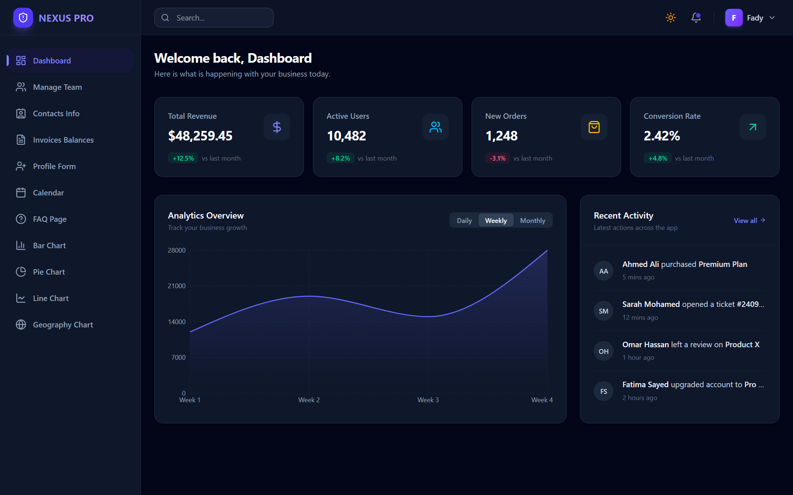
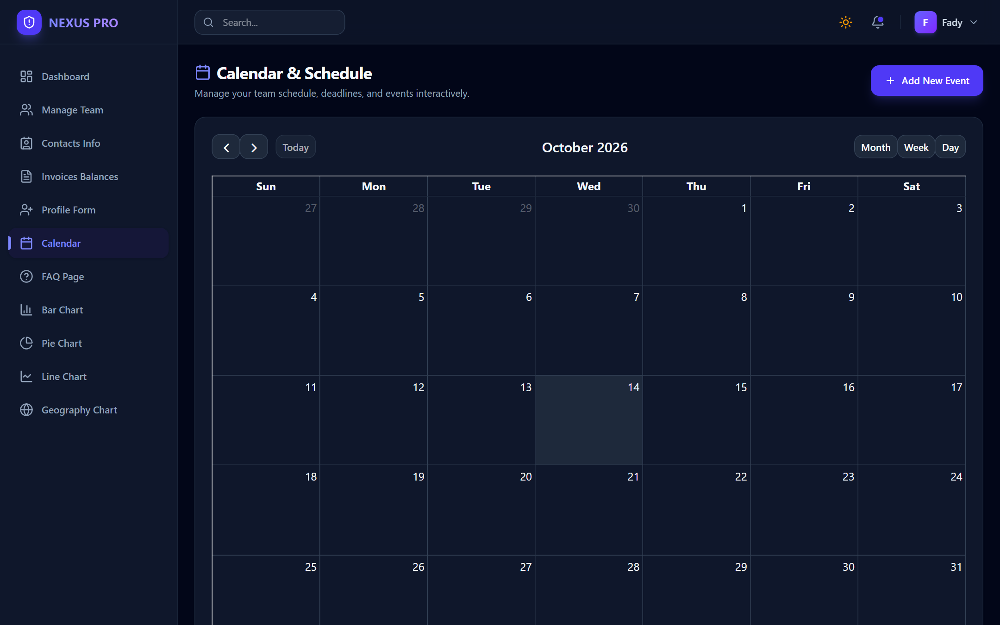
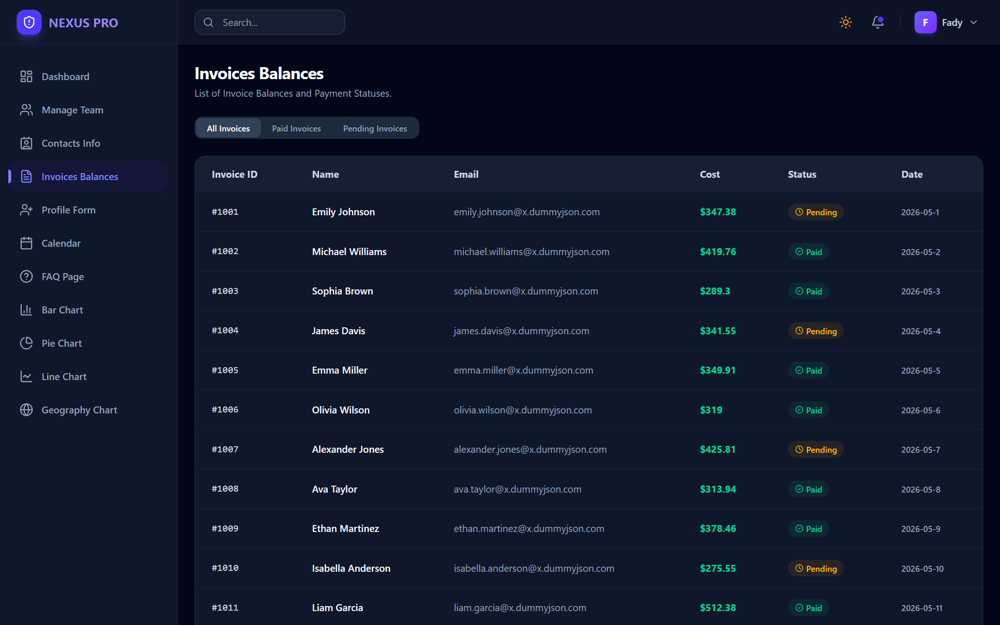
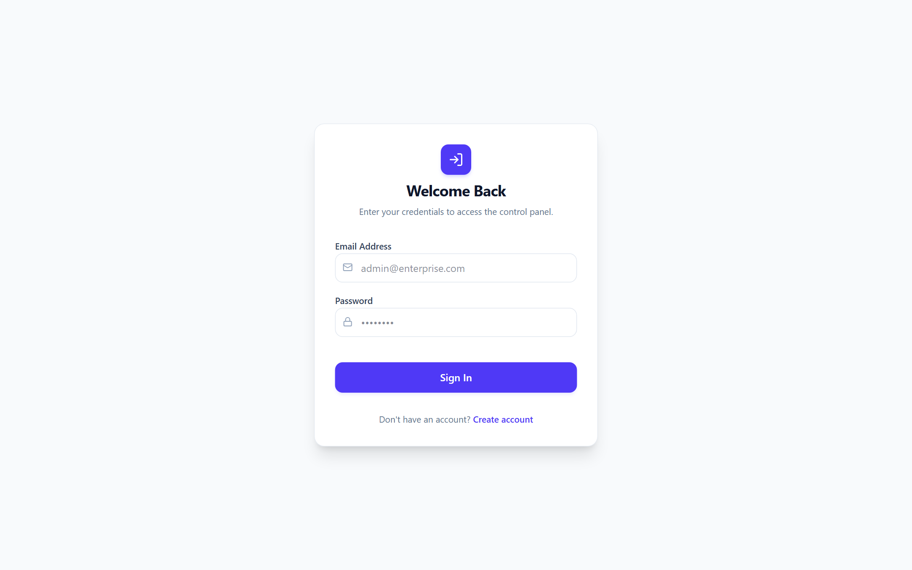
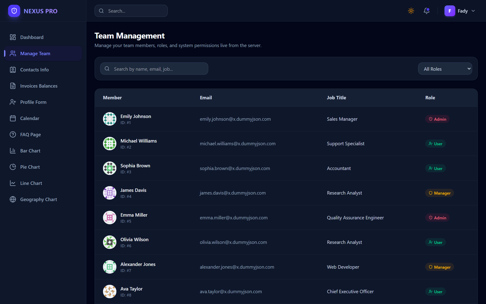

<div align="center">


</div>

<div align="center">

[](https://dashboard-flax-two-20.vercel.app/login)
[](https://github.com/Fady519/Dashboard)
[](https://www.linkedin.com/in/fady-kaiser/)
[](https://fady519.github.io/Portfolio-Fady/)

</div>

---

<div align="center">

## 🖥️ A frontend admin dashboard built with Next.js 16

**Next.js 16 App Router · React 19 · TypeScript · Tailwind CSS 4 · Recharts · FullCalendar · React Hook Form + Zod · Dark / Light Mode**

A practice project focused on the frontend: layouts, charts, forms, a calendar and a responsive shell.
There is no backend: sample data comes from [DummyJSON](https://dummyjson.com) and from local arrays, and the login is a demo stored in the browser.

</div>

---

## 🌐 Live Preview

<div align="center">

> 🔗 **Live URL:** [dashboard-flax-two-20.vercel.app](https://dashboard-flax-two-20.vercel.app/login)  
> 🔐 **Demo account:** `admin@admin.com` / `admin` (or click **Use demo account** on the login page)

</div>

### 1. Overview: KPI Cards & Revenue Chart


### 2. FullCalendar Scheduler


### 3. Invoices Table with Status Filter


### 4. Login Page


### 5. Team List


---

## ✨ Features

| Feature | Description |
|---|---|
| 🔐 **Demo Login & Route Guard** | Register / login stored in the browser (`localStorage` + `sessionStorage`); the root layout redirects to `/login` when there is no session. This is a frontend demo, not real authentication |
| 🌗 **Dark / Light Mode** | Theme saved in `localStorage` and applied by an inline script in `<head>` before the first paint, so the page does not flash the wrong theme |
| 📅 **FullCalendar Scheduler** | Month / week / day views, click a date to add an event, drag and drop to move it, click to delete; events are saved in `localStorage` |
| 📊 **Charts** | Area, bar, line and pie charts with Recharts, plus a daily / weekly / monthly switch on the overview chart |
| 🧾 **Invoices** | Table built from DummyJSON users with a paid / pending filter |
| 👥 **Team & Contacts** | Lists loaded from DummyJSON with search and a role filter (the roles are display badges) |
| 🗺️ **Geography** | 3D globe (`react-globe.gl`) with sample country data; click a country to focus the camera on it |
| 📝 **Validated Form** | Profile form built with React Hook Form and a Zod schema |
| 📱 **Responsive Shell** | Collapsible sidebar, mobile drawer and layouts that work from phone to desktop |

---

## 🛠️ Tech Stack

<div align="center">

### Framework & Language


### Styling & UI


### Charts, Calendar & Forms


</div>

---

## 🗂️ Pages

```
📊 Overview      → KPI cards, revenue area chart (daily / weekly / monthly), recent activity
👥 Team          → Team list from DummyJSON with search and role filter
📇 Contacts      → Contact list from DummyJSON with search
🧾 Invoices      → Invoices table with paid / pending filter
📝 Form          → Profile form (React Hook Form + Zod)
📅 Calendar      → FullCalendar with add / move / delete, saved in localStorage
📊 Bar & Pie     → Sample sales and category charts
📈 Line          → Sample weekly trend chart
🗺️ Geography     → 3D globe with sample country data
❓ FAQ           → Accordion page
```

---

## 📁 Repository Structure

```
Dashboard/
├── app/
│   ├── layout.tsx         # Root layout: theme script, route guard, sidebar + topbar, toaster
│   ├── page.tsx           # Overview
│   ├── login/             # Login (with demo account)
│   ├── register/          # Register (saved in localStorage)
│   ├── calendar/          # FullCalendar scheduler
│   ├── team/              # Team list
│   ├── contacts/          # Contacts list
│   ├── invoices/          # Invoices table
│   ├── form/              # Profile form
│   ├── barChart/          # Bar chart
│   ├── pieCharts/         # Pie chart
│   ├── lineChart/         # Line chart
│   ├── geography/         # 3D globe
│   └── faq/               # FAQ
│
├── components/
│   ├── Sidebar.tsx        # Collapsible navigation, mobile drawer
│   ├── Topbar.tsx         # Theme toggle, user menu, logout
│   ├── StatCard.tsx       # KPI card
│   └── RecentActivity.tsx # Activity list on the overview
│
└── docs/screenshots/      # README screenshots
```

---

## 🚀 Getting Started

### Prerequisites
- [Node.js 20+ & npm](https://nodejs.org/)

### Installation & Local Run
```bash
# 1. Clone the repository
git clone https://github.com/Fady519/Dashboard.git
cd Dashboard

# 2. Install dependencies
npm install

# 3. Start the Next.js development server
npm run dev

# The dashboard runs at http://localhost:3000
```

---

<div align="center">

[](https://www.linkedin.com/in/fady-kaiser/)
[](https://github.com/Fady519)
[](https://fady519.github.io/Portfolio-Fady/)


</div>
